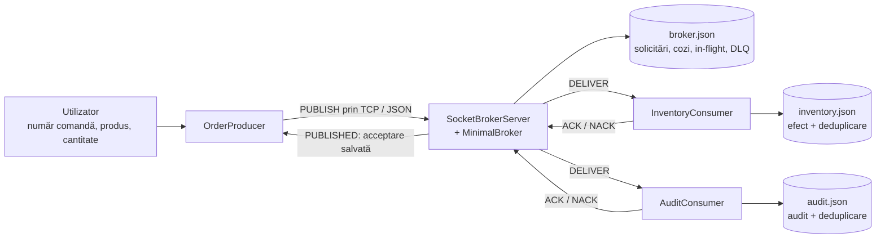

# Schemele logicii aplicației — laboratorul 1

Aceste scheme descriu implementarea Java existentă. Nu adaugă funcționalități.
Diagramele sunt scrise în Mermaid, în blocuri din README-uri. Pe GitHub apar ca
diagrame; în IntelliJ se pot vedea în previzualizarea Markdown dacă suportul Mermaid
este disponibil. Codul diagramei rămâne lizibil și ca text.

## Ordinea recomandată de citire

1. [Fișiere și date](fisiere-si-date/README.md): responsabilitățile claselor și locul datelor.
2. [Flux normal](flux-normal/README.md): apeluri locale, comunicare TCP, PUBLISHED și ACK.
3. [Retry și recuperare](retry-recuperare/README.md): crash înainte de ACK, deduplicare și DLQ.
4. [Diagrama de secvență existentă](sequence.md): vedere compactă asupra întregului scenariu.

## Componentele care comunică

Inventory și Audit primesc fiecare mesajul dacă destinația este „toți”.
Pentru un destinatar ales, numai coada lui primește mesajul.
Nu există un apel TCP direct între producer și consumatori.

## Cum citești săgețile

- O legătură între două clase din același proces înseamnă un apel Java.
- O legătură marcată TCP înseamnă un mesaj serializat JSON între socket-uri.
- O legătură spre un fișier înseamnă citire/scriere pe disc prin JsonFileStore.
- În diagrama de secvență, timpul curge de sus în jos, iar săgețile punctate indică răspunsuri.
- PUBLISHED confirmă acceptarea la broker. ACK confirmă efectul unui consumator.

Nu se transferă fișiere Java prin rețea: comunică obiectele create din clasele respective.
MessageEnvelope descrie datele mesajului, iar WireMessage descrie comanda protocolului.

## Cele două variante de pornire

| Variantă | Ce pornește | Date |
|---|---|---|
| Procese separate | BrokerMain, InventoryConsumer, AuditConsumer, OrderProducer | data/broker.json, inventory.json, audit.json |
| DemoMain | Broker și consumatori în același JVM, în fire diferite; comunicarea folosește tot TCP | subdirector nou data/demo-* |

DemoMain înlocuiește instanța Inventory după oprirea ei. Testul ProcessCrashTest
pornește consumatori în procese JVM separate și verifică și căderea reală a procesului.
Nu porni simultan DemoMain și BrokerMain pe același port.
