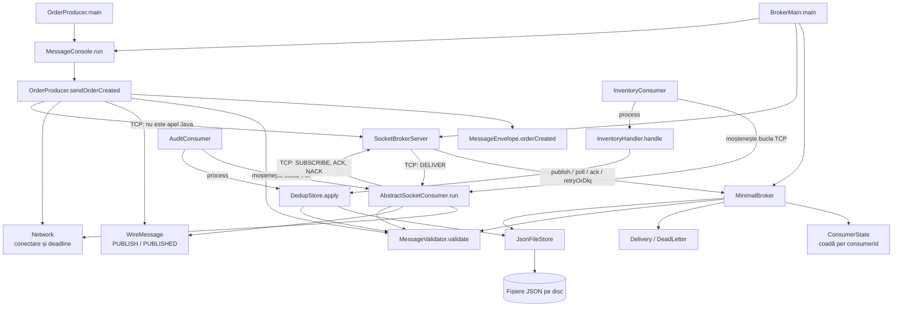
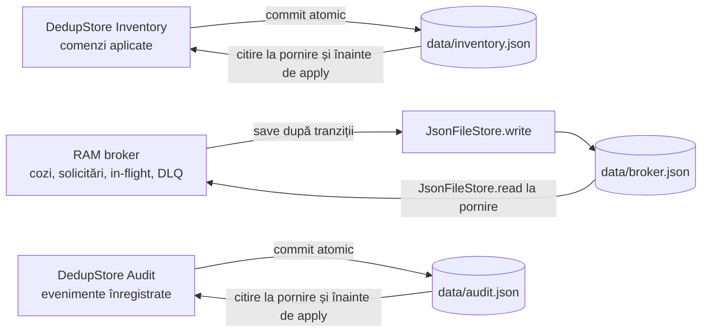

# Legătura dintre fișierele Java și date

## Cine apelează pe cine

Săgețile „moștenește” arată o relație între clase, nu un apel de rețea.
AbstractSocketConsumer apelează process(message), iar implementarea concretă
aleasă este InventoryConsumer.process sau AuditConsumer.process.
Inventory și Audit folosesc instanțe separate de DedupStore și fișiere separate.

AppConfig furnizează configurația componentelor. LogUtil este apelat în producer,
broker și consumatori pentru a afișa același messageId și correlationId.
Aceste utilitare sunt omise din unele legături pentru a păstra diagrama lizibilă.

## Responsabilități

| Fișier | Ce face |
|---|---|
| MessageConsole.java | Citește datele, verifică introducerea și alege destinatarul |
| OrderProducer.java | Creează și validează mesajul, trimite PUBLISH, verifică PUBLISHED |
| MessageEnvelope.java | Definește câmpurile și generează identități stabile din numărul comenzii |
| WireMessage.java | Definește PUBLISH, SUBSCRIBE, SUBSCRIBED, DELIVER, PUBLISHED, ACK și NACK |
| MessageValidator.java | Verifică versiunea, ID-urile, timestamp-ul și produsul/cantitatea |
| SocketBrokerServer.java | Primește JSON prin TCP, gestionează abonamentele și așteaptă confirmări |
| MinimalBroker.java | Gestionează solicitări, rutare, cozi, in-flight, retry, ACK și DLQ |
| ConsumerState.java | Conține canalul și coada unui consumator |
| AbstractSocketConsumer.java | Primește DELIVER, apelează process și trimite ACK/NACK |
| InventoryHandler.java | Înregistrează efectul prin DedupStore și poate injecta crash înainte de ACK |
| DedupStore.java | Salvează atomic efectul și identitatea; ignoră repetarea aceleiași solicitări |
| AuditConsumer.java | Salvează evenimentul de audit prin propriul DedupStore |
| JsonFileStore.java | Citește snapshot-uri și salvează prin fișier temporar + înlocuire atomică |
| Network.java | Conectare cu buget explicit și închiderea socket-ului la deadline |
| AppConfig.java | Citește deployment/application.properties și suprascrierile JVM |
| LogUtil.java | Afișează logurile corelate |

## Ce se află în RAM și pe disc

În broker.json, requests păstrează solicitările, routes destinațiile,
consumers cozile și inFlight, iar deadLetters livrările eșuate.
În inventory.json și audit.json, applied este o mapare de la numărul comenzii
la mesajul aplicat. Pentru Inventory, înregistrarea însăși reprezintă efectul local:
effectCount este 1 dacă acea comandă există și 0 dacă nu există.

După ACK dispare livrarea din inFlight, dar solicitarea rămâne în istoric
pentru a preveni o nouă publicare a aceleiași comenzi.
Datele rămân după restart dacă fișierele sunt păstrate.
Salvarea consolei într-un log ajută diagnosticul; reluarea livrărilor folosește snapshot-urile JSON.

## Identificatori diferiți

| Câmp | Exemplu / sens |
|---|---|
| key | ORD-1001: identitatea solicitării/comenzii |
| id | UUID stabil pentru evenimentul ORDER_CREATED al acelei comenzi |
| correlationId | UUID stabil al fluxului, propagat în mesaj și afișat în loguri |
| timestamp | Momentul creării mesajului; brokerul păstrează primul mesaj acceptat |
| schemaVersion | 1.0: versiunea contractului acceptat |

Producerul derivează ID-urile din numărul comenzii. Aceleași date și aceeași destinație
pot fi retrimise fără efect nou; datele/destinația schimbate sub același număr sunt respinse.
