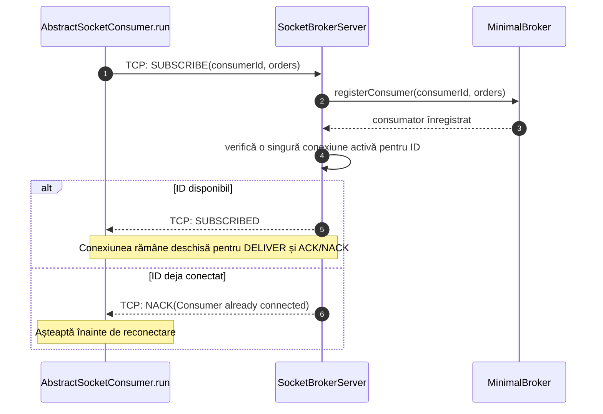
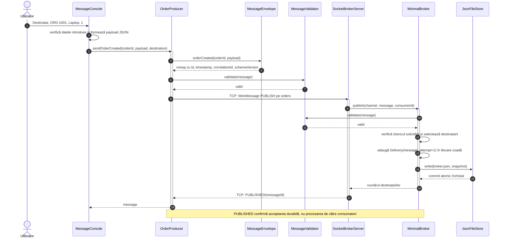
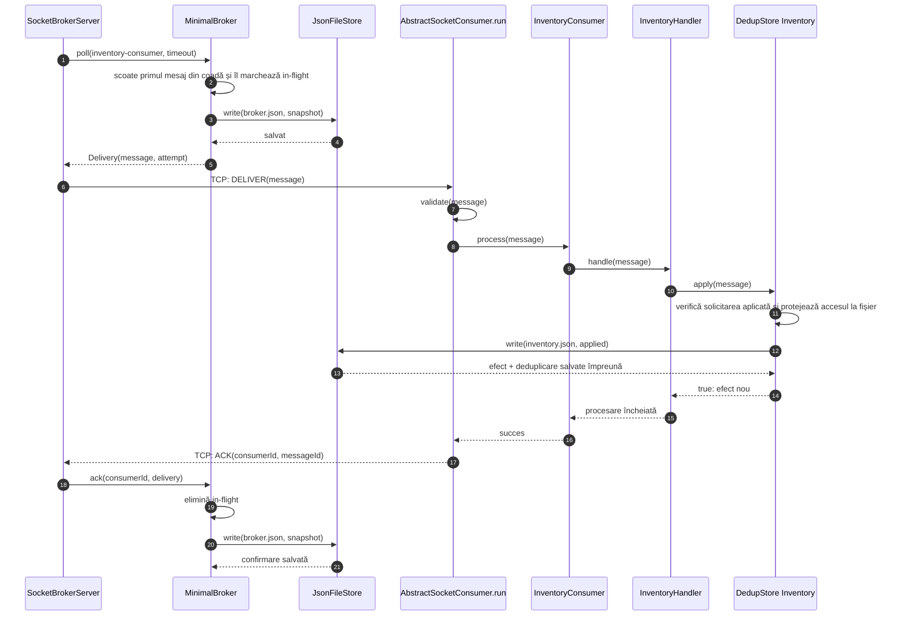
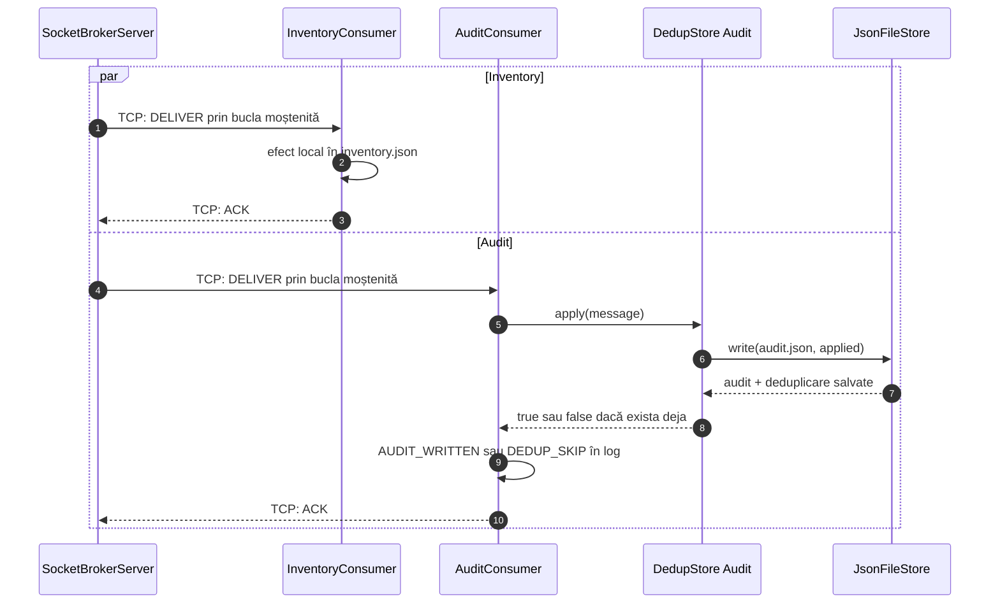

# Diagrame de secvență — fluxul normal

Diagramele arată obiectele din fișierele Java și mesajele efectiv transmise.
Săgețile TCP separă procesele; celelalte reprezintă apeluri locale.

## 1. Abonarea unui consumator

BrokerMain preînregistrează Inventory și Audit. Mesajele lor pot aștepta în cozi
și dacă procesele consumatoare nu sunt încă pornite.

## 2. Introducerea și publicarea comenzii

În cazul unei repetări identice, brokerul recunoaște solicitarea și răspunde PUBLISHED
fără a adăuga livrări noi. Dacă numărul există cu alte date sau altă destinație,
publicarea este respinsă prin NACK.

## 3. Livrarea către Inventory și confirmarea efectului

AbstractSocketConsumer.run este metoda moștenită de InventoryConsumer.
process este metoda implementată în clasa concretă.
LOCAL_EFFECT_DONE apare după commit-ul local; ACK este trimis după revenirea din process.

## 4. Ramura Audit și independența consumatorilor

ACK este emis de AbstractSocketConsumer după succesul metodei process.
Ordinea dintre Inventory și Audit poate varia. Chiar și o livrare poate începe
înainte ca producerul să afișeze PUBLISHED, deoarece conexiunile sunt servite concurent.
FIFO este per consumator; nu există ordonare globală între cele două ramuri.
