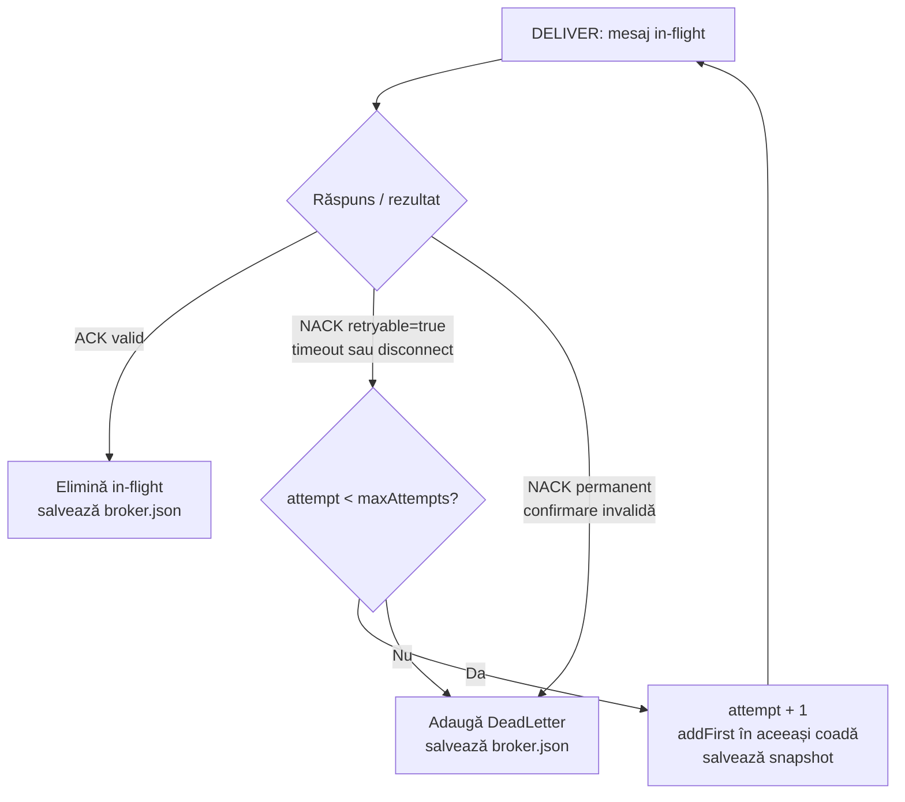
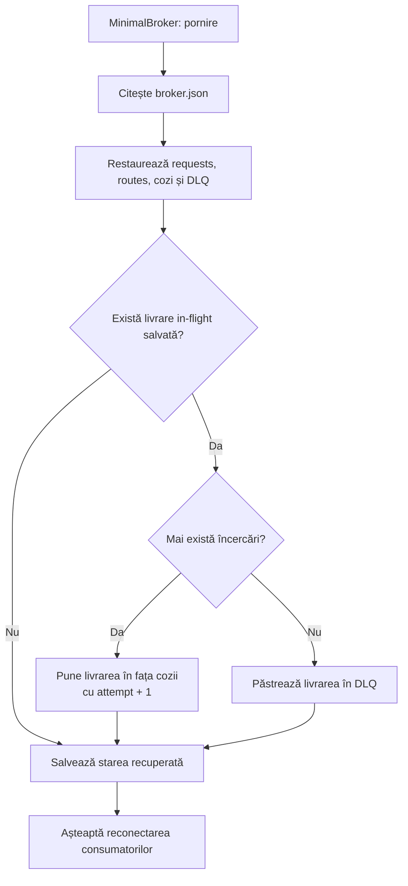

# Crash, retry, deduplicare și DLQ

## 1. Crash după efect, înainte de ACK

```mermaid
sequenceDiagram
    autonumber
    participant S as SocketBrokerServer
    participant B as MinimalBroker
    participant I1 as Inventory instanța inițială
    participant F as inventory.json
    participant I2 as Inventory repornit
    S->>B: poll(inventory-consumer)
    B-->>S: Delivery attempt=1, salvată in-flight
    S->>I1: TCP: DELIVER(messageId=M, correlationId=C)
    I1->>F: commit atomic: efect local + deduplicare
    F-->>I1: salvare încheiată
    I1->>I1: injectare crash în InventoryHandler.handle
    I1--xS: conexiune pierdută înainte de ACK
    Note over I1: Cu --crash-process JVM se oprește cu exit 23
    S->>B: retryOrDlq(disconnect, retryable=true)
    B->>B: attempt=2 în fața cozii, snapshot broker salvat
    I2->>F: citește efectele persistente
    F-->>I2: comanda a fost deja aplicată
    I2->>S: TCP: SUBSCRIBE(inventory-consumer, orders)
    S-->>I2: TCP: SUBSCRIBED
    S->>B: poll(inventory-consumer)
    B-->>S: Delivery attempt=2
    S->>I2: TCP: DELIVER, același M și C
    I2->>I2: DedupStore.apply -> false; DEDUP_SKIP
    I2-->>S: TCP: ACK
    S->>B: ack(consumerId, delivery)
    B->>B: elimină in-flight și salvează snapshot
    Note over F,I2: Un singur efect local, deși au existat două livrări
```

DemoMain oprește prima instanță și creează una nouă, în același JVM.
ProcessCrashTest demonstrează oprirea și repornirea unui proces JVM separat.
În ambele variante, noua instanță citește starea salvată pe disc.
Nu apare un efect extern separat: înregistrarea persistentă însăși este efectul local.

## 2. Decizia dintre ACK, retry și DLQ



Implicit, maxAttempts este 3: prima livrare și două retry-uri.
DLQ este per livrare către un consumator: Audit poate fi confirmat,
în timp ce aceeași comandă pentru Inventory ajunge în DLQ.
Un consumator care nu este conectat nu consumă încercări doar prin așteptare.
Un contract invalid la publicare este respins înainte de coadă.

## 3. Restart-ul brokerului



O livrare deja confirmată și salvată nu reapare după restart.
Dacă brokerul nu a salvat ACK-ul înainte de cădere, livrarea poate reapărea:
deduplicarea consumatorului protejează efectul local.

## Ce se verifică și care este limita

| Verificare | Test |
|---|---|
| Efect unic după crash real și restart | ProcessCrashTest |
| Recuperare in-flight înaintea următorului mesaj | RecoveryTest |
| Maximum 3 încercări și DLQ | DlqTest |
| Timeout ACK, FIFO, NACK permanent și abonament duplicat | SocketPolicyTest |
| Commit eșuat fără confirmare falsă | StorageFailureTest |

Politica permite livrări repetate și retry limitat. Deduplicarea oferă efect local
idempotent în condițiile stocării persistente disponibile; nu declară exactly-once
pentru servicii externe. DLQ înseamnă eșec păstrat pentru diagnostic, nu procesare reușită.
Nu sunt acoperite pierderea fișierelor, defectarea discului, replicarea brokerului sau
efectele externe care nu folosesc același mecanism atomic.
