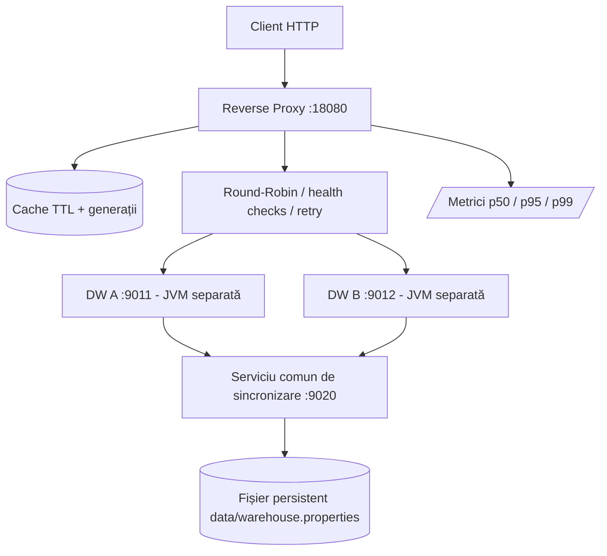

# Arhitectura laboratorului 3

DW A și DW B rulează în procese separate și folosesc același serviciu de stocare. Un DW căzut poate reveni fără sincronizare manuală. Serviciul de stocare rămâne un punct unic de eșec.
